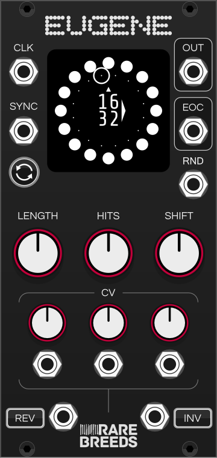
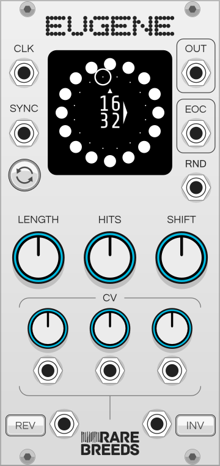
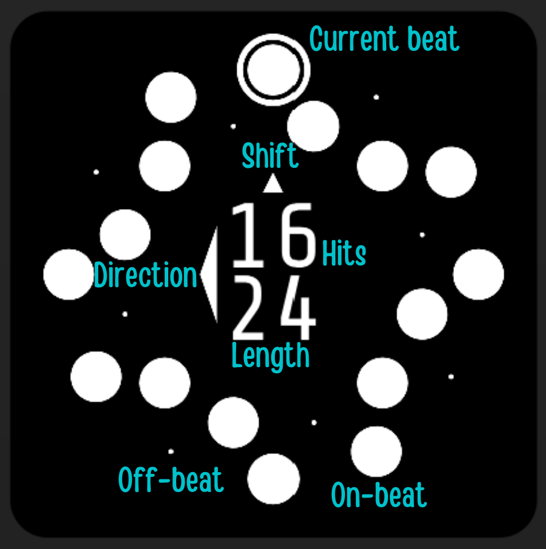

*Eugene* is a [Euclidean rhythm](https://en.wikipedia.org/wiki/Euclidean_rhythm) generator.
A Euclidean rhythm spreads a number of *hits* as evenly as possible over a number of *steps*, which produces many of the rhythms found in music around the world: 3 hits in 8 steps is the Cuban tresillo, and 5 in 8 the cinquillo.

 

Patch a clock into **CLK**. Each rising edge plays the next step of the rhythm, and **OUT** sends a trigger on every step that's a hit.

The **LENGTH** knob sets the number of steps in the rhythm, from 1 to 32.

The **HITS** knob sets how many of those steps are hits, from none to all of them.
It's a proportion of the length, so the rhythm keeps the same density as the length changes; its tooltip shows the number of hits being played, e.g. "5 / 16".

The **SHIFT** knob rotates the rhythm clockwise by up to 31 steps, wrapping around at the length.
Rotating it changes which part of the pattern plays first.

Rhythms always start at step 0, at 12 o'clock on the display.
A rising edge on the **SYNC** input, or pressing the button below it, restarts the rhythm there, so it can be kept in time with another sequencer or a reset signal.
If the length is shortened past the current step, the rhythm also restarts from step 0.

**REV** plays the rhythm backwards (anticlockwise); after a restart it starts from the last step.
**INV** swaps hits and rests: the steps that were hits are silent and the rest play.

##### Display

Each step is a circle around the display: hits are large circles and rests small dots.
When inverted, hits are shown as outlines instead.
The step that has just played is circled, and the triangle shows the shift, pointing at the step where the unrotated rhythm now starts.
In the middle are the number of hits (top) and the length (bottom), with an arrow showing the direction of play.

##### CV

LENGTH, HITS and SHIFT each have a CV input and an attenuator knob above it.
The input takes ±5V, which is scaled by the attenuator (0% to 100%) and added to the knob:
at 100%, +5V adds the knob's whole range (31 steps of length or shift, or 100% of hits) and -5V takes it away.
The knobs' tooltips show the value being played, including CV.

The CV inputs next to REV and INV are gates that override their buttons while patched: above 1V turns reverse or invert on, and 0V or below turns it off.

A rising edge on the **RND** input randomizes the module, the same as Rack's *Randomize* (Ctrl/Cmd+R).

##### Outputs

**OUT** sends a 10V signal on each hit, shaped by **Beat Mode** in the context menu:

- **Pulse** (default): a 1 ms trigger on each hit.
- **Gate**: high on hits and low on rests, with a 1 ms gap at the start of each hit so that consecutive hits retrigger.
- **Hold**: high on hits and low on rests, staying high through consecutive hits.

**EOC** (end of cycle) sends a 1 ms trigger once per cycle of the rhythm. Its timing is set by **EOC Mode** in the context menu:

- **On Repeat** (default): on the first step of a cycle that follows the last step of the previous one, so not when the rhythm first starts or is restarted part way through.
- **First**: on the first step of every cycle, including after a restart.
- **Last**: on the last step of every cycle.

When reversed, the first and last steps are those in the direction of play.

##### Settings

Right-click the panel for these settings, as well as the Theme and Orbits light boost settings described in the [Orbits manual](plugin.md).

- **Beat Mode** and **EOC Mode**: see Outputs above.
- **Randomize Filter**: chooses which settings Randomize and the RND input change: Length, Length CV, Hits, Hits CV, Shift, Shift CV, Reverse and Invert. All are on by default.

When Eugene is bypassed, its CLK input is passed straight through to OUT.

##### Presets

Eugene comes with factory presets of rhythms from around the world and from well-known songs, such as Bossa Nova, Samba, Tresillo and Take Five. Find them under *Preset* in the context menu.
