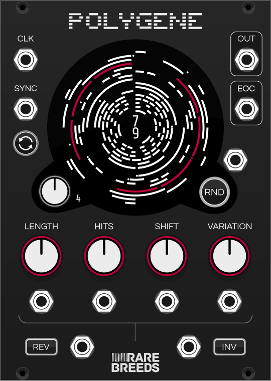
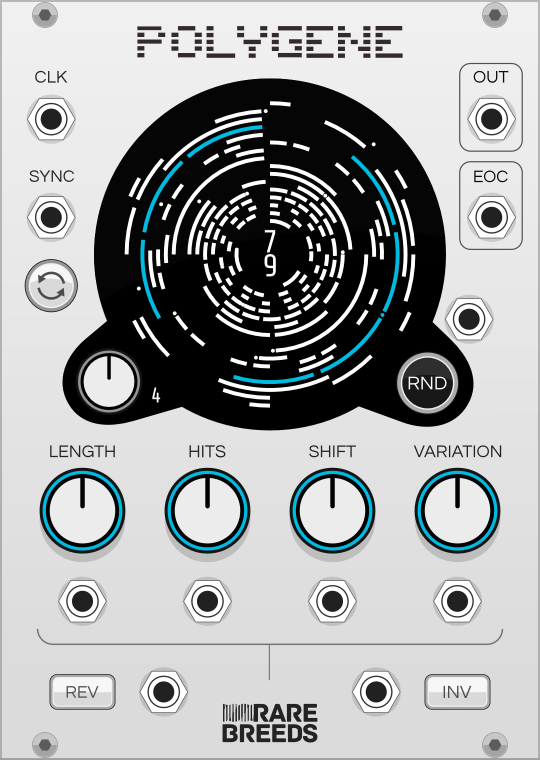

*Polygene* is a polyphonic rhythm generator: it plays up to 16 rhythms at once, one per channel of a polyphonic cable.
Like [Eugene](RareBreeds_Orbits_Eugene.md), each rhythm spreads a number of *hits* over a number of *steps*, and the **VARIATION** knob gives other ways to spread them besides the most even, [Euclidean](https://en.wikipedia.org/wiki/Euclidean_rhythm), one.

 

Patch a clock into **CLK**. Each channel of the clock plays its own rhythm: a rising edge on a channel plays that rhythm's next step, and **OUT** and **EOC** have one channel per clock channel.
To clock several rhythms from one clock, copy it to the number of channels you need, for example with *VCV Merge*, or a polyphonic clock module.

##### Editing a channel

The **channel knob** at the bottom left of the display chooses which channel the knobs and buttons edit, from 1 to 16; its number is shown next to it.
Turning it moves the knobs to that channel's settings. Each channel keeps its own settings, whether or not it's clocked.

The **LENGTH** knob sets the number of steps in the rhythm, from 1 to 32.

The **HITS** knob sets how many of those steps are hits, as a proportion of the length; its tooltip shows the number of hits being played, e.g. "5 / 16".

The **SHIFT** knob rotates the rhythm clockwise by up to 31 steps, wrapping around at the length.

The **VARIATION** knob chooses between the different ways of spreading the hits over the steps.
Fully anticlockwise is variation 1, the Euclidean rhythm; each step clockwise moves one hit by one step.
No variation is a rotation of an earlier one, though mirror images can appear.
The number of variations depends on the length and hits, and the tooltip shows which is playing, e.g. "4 / 12".

**REV** plays the channel's rhythm backwards (anticlockwise). **INV** swaps its hits and rests.

Every rhythm starts at step 0, at 12 o'clock. A rising edge on a channel of the **SYNC** input restarts that channel's rhythm there, and the button below the input restarts every channel.
If a channel's length is shortened past its current step, it also restarts from step 0.

The **RND** button randomizes the channel being edited, and repeats while held. It can be undone.
Rack's *Randomize* (Ctrl/Cmd+R) randomizes every channel.

##### Display

Each channel is a ring of the display, channel 1 on the outside and channel 16 nearest the middle.
Each hit is a dash, and a dot shows where the channel is in its rhythm.
The channel being edited is in the accent colour (red in the Dark theme, blue in the Light), channels that are clocked are white, and the rest are grey.
In the middle are the edited channel's number of hits (top) and length (bottom).

##### CV

Every CV input is polyphonic, one channel per rhythm.

LENGTH, HITS, SHIFT and VARIATION each have a CV input below the knob, which takes ±5V and adds it to the knob:
+5V adds the knob's whole range (31 steps of length or shift, or 100% of hits or variation) and -5V takes it away.
The knobs' tooltips show the edited channel's value, including CV.

The CV inputs next to REV and INV are gates that override the buttons while patched: above 1V turns reverse or invert on, and 0V or below turns it off.

A rising edge on a channel of the **RND input**, to the right of the display, randomizes that channel. Unlike the button, this doesn't add to the undo history.

Following Rack's polyphony standard, a mono cable patched into a polyphonic input controls every channel.
Use **Mono Input Behavior** in the context menu to make a mono cable control only channel 1 instead, separately for Sync, Length, Hits, Shift, Variation and Random.

##### Outputs

**OUT** sends 10V on each hit, shaped by **Beat Mode** in the context menu:

- **Pulse** (default): a 1 ms trigger on each hit.
- **Gate**: high on hits and low on rests, with a 1 ms gap at the start of each hit so that consecutive hits retrigger.
- **Hold**: high on hits and low on rests, staying high through consecutive hits.

**EOC** (end of cycle) sends a 1 ms trigger on each channel once per cycle of its rhythm. Its timing is set by **EOC Mode** in the context menu:

- **On Repeat** (default): on the first step of a cycle that follows the last step of the previous one, so not when the rhythm first starts or is restarted part way through.
- **First**: on the first step of every cycle, including after a restart.
- **Last**: on the last step of every cycle.

When reversed, the first and last steps are those in the direction of play.

##### Settings

Right-click the panel for these settings, as well as the Theme and Light boost settings described in the [Orbits manual](plugin.md).

- **Beat Mode** and **EOC Mode**: see Outputs above.
- **Randomize Filter**: chooses which settings the RND button, the RND input and Randomize change: Length, Hits, Shift, Variation, Reverse and Invert. All are on by default.
- **Mono Input Behavior**: see CV above.

##### Presets

Polygene comes with the same factory presets as Eugene, which set the channel being edited, and *[Poly]* presets that set a different rhythm on each channel, such as Four On The Floor, Samba and standard 8th and 16th note grooves. Find them under *Preset* in the context menu.
