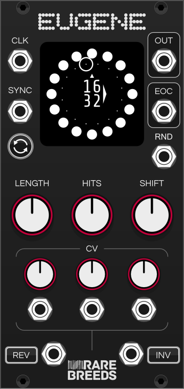
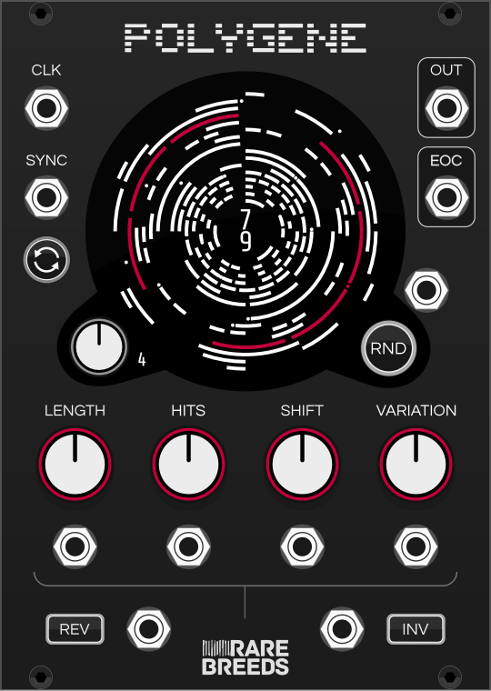
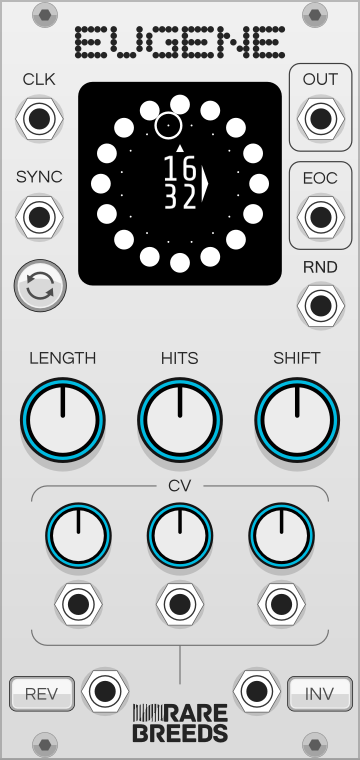
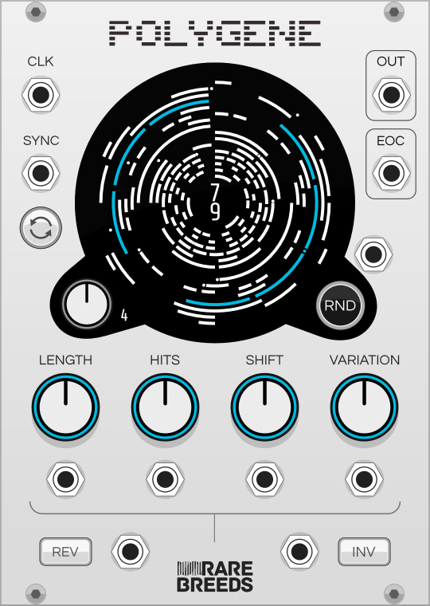

Orbits is a pair of rhythm generators for [VCV Rack](https://vcvrack.com/), based on [Euclidean rhythms](https://en.wikipedia.org/wiki/Euclidean_rhythm): a number of hits spread as evenly as possible over a number of steps.

   

- [Eugene](RareBreeds_Orbits_Eugene.md): a Euclidean rhythm generator.
- [Polygene](RareBreeds_Orbits_Polygene.md): up to 16 rhythms on one polyphonic cable, each with its own variations around the Euclidean rhythm.

Orbits is [open source](https://github.com/RareBreeds/Orbits/). See the [changelog](https://github.com/RareBreeds/Orbits/blob/v2/CHANGELOG.md) for what's new in each version. If you enjoy it, you can [buy me a coffee](https://ko-fi.com/RareBreeds).

##### Settings shared by both modules

Right-click either module to find these:

- **Theme**: **Follow Rack** (the default for new modules) uses the Light theme, or the Dark theme when "Use dark panels if available" is on in Rack's View menu. **Dark** and **Light** keep that theme whatever Rack's setting is.
- **Light boost**, under **Plugin**: how much brighter than Rack's room lighting the displays and lit buttons are, from 0% to 100%, 30% by default. It applies to every Eugene and Polygene module and is saved with Rack's settings rather than the patch.

##### Videos and links

- [Omri Cohen - 5 New Modules to experiment with in VCV Rack in January 2021](https://www.youtube.com/watch?v=LTSPj2sUYtg&t=1590s)
- [Omri Cohen - What do Euclidean Sequencers have to do with Polyrhythms and Polymeters?](https://youtu.be/TSYzCZTIFaY?t=360)
- [Your Pal Rob - Instant Rhythms: Eugene by RareBreeds](https://www.youtube.com/watch?v=hbN5FpP-Q7k)
- [Your Pal Rob - Instant Rhythms 2: Polygene by RareBreeds](https://www.youtube.com/watch?v=R40nj87Iscs)
- [VCV Rack Ideas - PolyGene - powerful 16 track euclidean sequencer in VCV Rack](https://www.youtube.com/watch?v=5q7ujPrInZo)
- [VCP Challenge #59: RareBreeds Eugene](https://community.vcvrack.com/t/vcp-challenge-59-rarebreeds-eugene/12350)
